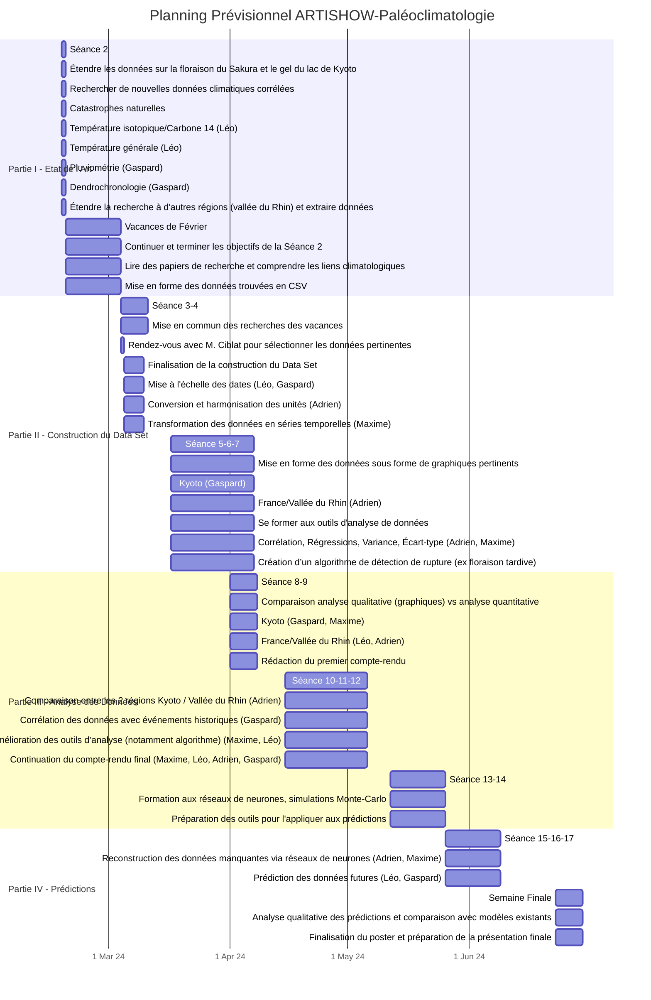

  # Planning

## Grands axes de notre projet

1) Etat de l'art : chercher d'une part à étendre les données jusqu'à nos jours et à définir d'autres caractéristiques climatiques (température, pluviomètrie). Peut-être étendre à d'autres régions géographiques.
2) Construire le dataset : choix de la mise en forme des donnée.
3) Analyse : Recherche de corrélations (hiver tardif/précoce) et détection d'événements (notamement les éruptions volcaniques) => Essayer de développer ou au moins d'utiliser un algorithme de détection d'événements.
4) Prédiction : Chercher à  compléter les données manquantes par différents modèles et potentiellement l'entraînement d'un réseau de neurones. 

## Dates importantes

- **24/02** : évaluation du planning de projet proposé par les étudiants.
- **Entre le 07/04 et 18/04** : évaluation mi-parcours.
- **09/05** : participation à l’audit étudiant.
- **27/06** : évaluation finale.

